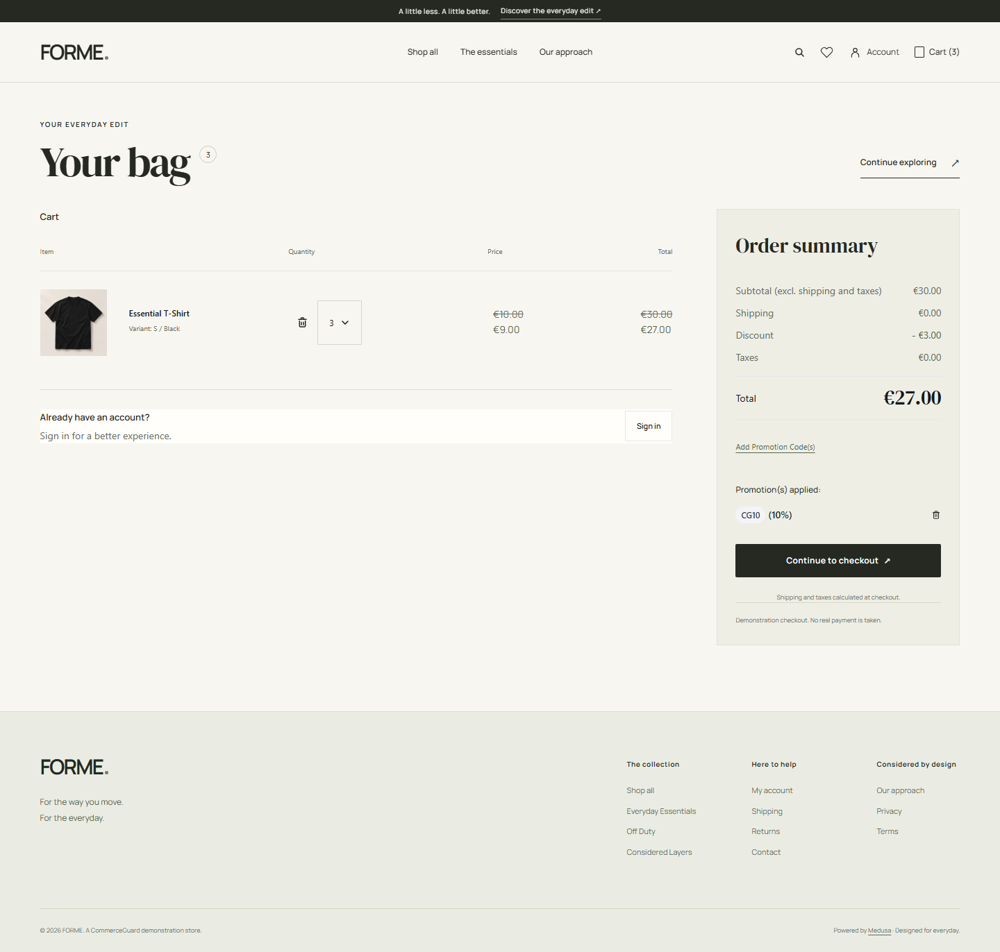
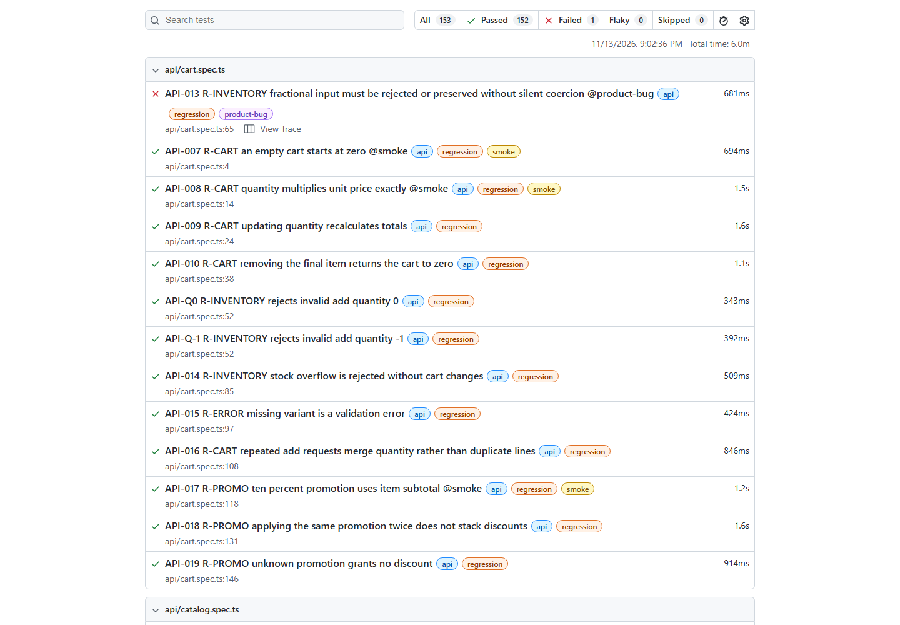
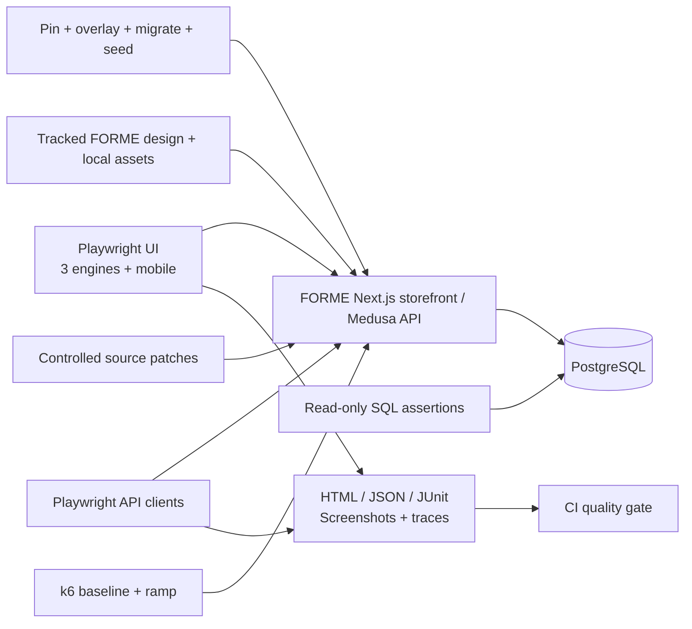

# CommerceGuard

[](https://github.com/EliyahuEden/CommerceGuard/actions/workflows/smoke.yml)
[](https://github.com/EliyahuEden/CommerceGuard/actions/workflows/regression.yml)
[](https://github.com/EliyahuEden/CommerceGuard/actions/workflows/performance.yml)

**Enterprise-style QA automation and an evidence-driven release quality gate for a
real e-commerce application.** Built as an SDET portfolio: test important purchase,
money and customer-isolation rules, verify persisted data, and prove selected tests
can catch deliberately introduced defects.

CommerceGuard is the original TypeScript QA framework. **FORME** is its custom
apparel-storefront design: editorial photography, warm ivory surfaces, expressive
typography, and responsive shopping, account and checkout pages. The real commerce
system remains the MIT-licensed [Medusa DTC Starter](https://github.com/medusajs/dtc-starter), pinned
to [`0a84b2a`](https://github.com/medusajs/dtc-starter/tree/0a84b2ac13dbf5091a84af4b54ce0b19f6c9ad55)
and prepared into ignored `.aut/`. The full upstream tree is not vendored. Our
tracked presentation overlay, assets, and catalog seed are separate under
[`storefront/`](storefront/) and [`aut/`](aut/).


See [shopping enhancements](docs/SHOPPING_ENHANCEMENTS.md),
[storefront decisions](docs/STOREFRONT.md) and
[current verification](docs/ENHANCEMENT_RESULTS.md). The original QA baseline remains
available in Git tag `baseline-medusa-qa` and the evidence below.

## Verified shopping-enhancement results — 14 November 2026

The local 13 November matrix executed **153 checks from 69 unique scenarios**:
**152 passed / 1 product failure**, with zero skips, retries or flaky outcomes,
in **357.81 seconds**. All **112 UI checks** across Chromium, Firefox, WebKit and
mobile Chromium, and all **six database integration checks**, passed.
API-013 exposes CG-B001: accepted quantity `1.5` becomes `2`. The failure remains
visible; it is not skipped or marked as expected failure.

The final **hosted** matrix also measured **152 passed / 1 product failure** in
208.85 seconds. All 112 browser and six integration checks passed. Hosted smoke
passed **22/22**, plus the keyboard audit; the separate hosted k6 baseline passed
108 requests with zero HTTP/business failures. Docker setup and cleanup executed
on the runner. [Verified hosted runs](docs/evidence/enhancements/hosted-actions.json).
Full regression remains red while CG-B001 is open; no assertion hides it.

The six enhancements include a varied ten-product catalog, size/fit/care and zoom,
mobile address validation, guest/account wishlist, order statuses/buy again, and
keyboard/axe accessibility checks. Read the
[current verification report](docs/ENHANCEMENT_RESULTS.md),
[full case outcomes](docs/evidence/enhancements/regression-results.json), and
[requirements audit](docs/REQUIREMENTS_AUDIT.md).
The critical smoke selection passed **66/66** across three explicit cycles without
retries. [Measured smoke outcomes](docs/evidence/enhancements/stability-results.json).
The [12 November redesign report](docs/archive/REDESIGN_RESULTS.md) preserves the earlier
117-execution campaign separately.

## Re-verified 16 November 2026 (local, Node 22.23.4)

After adding four API contract scenarios (API-036 to API-039: completed-order schema
and money invariants, one JSON error envelope, typed shipping prices, no credential
fields in customer responses) and a storefront polish pass, the full matrix executed
**157 checks from 73 unique scenarios** (39 API, 28 UI, 6 integration): **156 passed /
1 failed**, and the one failure is the tracked CG-B001 (API-013). A fresh baseline
smoke run on the rebuilt stack passed **22/22** before the polish. `npm run test:gate`
passed **156/156** (exit 0) and `npm run test:known-bugs` reported CG-B001 still
reproducing (exit 0), both run live.

The storefront polish removed decorative all-caps labels above headings and the
repeated card tag, raised text declared at 8-10px to 11px, and aligned money with
tabular numerals. **Honest note:** the first matrix after the polish had one failure
besides CG-B001, UI-019 on mobile Chromium. Its trace showed the closing menu panel,
visually gone, still intercepting clicks for the whole timeout. It passed 3 of 3 when
re-run alone, so it was intermittent. The panel now ignores pointer events while it
leaves. Two full matrices since then were clean (156/157 and the 156/156 gate), which
is encouraging but cannot prove an intermittent defect is gone. These matrix runs are
local; hosted smoke passed on this revision, hosted regression has not been run.

## Release gate and open product bugs

A permanently red pipeline hides new regressions, so the open upstream bug is tracked
instead of ignored:

| Command                   | Purpose                                                                                   | Passes when                                                                                      |
| ------------------------- | ----------------------------------------------------------------------------------------- | ------------------------------------------------------------------------------------------------ |
| `npm run test:gate`       | Release gate: every `@regression` test except `@product-bug`                              | No test fails (156 of 156 on the 16 November local run)                                          |
| `npm run test:known-bugs` | Runs only the tagged tests listed in [`defects/known-bugs.json`](defects/known-bugs.json) | Each registered bug **still fails**; a bug that starts passing, or a missing test, fails the job |
| `npm test`                | Everything, unfiltered                                                                    | Red while CG-B001 is open; nothing is skipped or marked as an expected failure                   |

CG-B001 (quantity `1.5` stored as `2`) is therefore visible in every run and in the
job summary, a new regression turns the gate red, and a fix upstream forces cleanup of
the tag, register entry and defect report. The register check was verified offline
against the saved 14 November report in both directions (still failing → exit 0,
simulated pass → exit 1). The gate split has been linted (actionlint) and executed locally.
The push-triggered smoke workflow passed on hosted Actions for this revision
([run 43835270151](https://github.com/EliyahuEden/CommerceGuard/actions/runs/43835270151)),
but the manually dispatched regression workflow that uses `test:gate` and
`test:known-bugs` **has not yet run on hosted Actions**.

## Reliability history with FlakeGuard

The scheduled regression uploads its Playwright JSON as an artifact named
`playwright-json-results`. [FlakeGuard](https://github.com/EliyahuEden/FlakeGuard) can
import it with `flakeguard sync EliyahuEden/CommerceGuard --artifact-pattern
'*playwright-json*'` (read-only token with Actions access), which turns weekly runs into
flaky-test and recurring-failure evidence. FlakeGuard's integration with this
repository's three archived reports is tested; live artifact sync from hosted runs has
not been exercised yet.

## Original QA baseline — 11 November 2026

| Campaign        | Measured outcome                                                                              |
| --------------- | --------------------------------------------------------------------------------------------- |
| Full matrix     | **104 passed / 1 product failure**, 105 executions, zero skips/retries                        |
| Smoke stability | **45/45 passed** — 15 critical cases repeated three times                                     |
| Seeded defects  | **5/5 detected and restored**, each with pass → fail → pass evidence                          |
| Local k6        | Baseline: 102 requests, p95 305.93ms; ramp: 327 requests, p95 246.91ms; all thresholds passed |

The open finding is accepted quantity `1.5` becoming `2` in both API and SQL. It stays
visible in full regression. Earlier compilation and transport failures, their fixes,
and the final repeat are preserved in the [test summary](docs/STR.md). At the time of that original campaign, Docker and hosted Actions had not
been executed. Later verification is recorded in the current requirements audit.

<details>
<summary>Current FORME storefront and regression-report screenshots</summary>

Three EUR 10 items with CG10 produce EUR 3 discount and EUR 27 total:



The measured report keeps the independently discovered API failure visible:



</details>

## What this project demonstrates

- 73 substantial scenarios: 39 API, 28 UI, 6 database/integration; four UI projects.
- Real product search/filtering, cart/stock boundaries, promotions, customer accounts,
  authorization, manual-payment checkout, order history and repeated completion.
- UI → API → PostgreSQL validation using parameterized read-only queries.
- Five reversible storefront defects with automated baseline/failure/restoration
  evidence; an independently discovered quantity-coercion issue is tracked separately.
- PR smoke gate, weekly/manual cross-browser regression and separate local k6 budgets.
- HTML/JSON/JUnit reporting with failure screenshots, video, traces and DOM context.
- Original storefront design, 13 optimized local photographs, real color-specific
  galleries, size/fit/care information, modal zoom, guest/account wishlist, retained
  checkout validation and current-status order details with buy again.
- Axe A/AA checks on eight routes in four browser projects, plus a separate full
  keyboard purchase audit. No accessibility certification is claimed.
- Risk-based STP, 19 manual scenarios, traceability, exploratory charters and honest
  measured results. No blanket retries, paid services or fabricated coverage metrics.

## Architecture



See [design decisions](docs/ARCHITECTURE.md) and [AUT inspection/setup](docs/AUT.md).

## Stack

TypeScript 7.0.2 · Playwright Test 1.65.0 / APIRequestContext · PostgreSQL 18.6 ·
Node 22.23.4 · Medusa 2.22.6 · Next.js 16.3.8 · Zod · pg · Docker Compose ·
GitHub Actions · k6 2.3.0. npm locks the QA repository; upstream uses its frozen
pnpm lockfile; the reviewed runner is pnpm 10.34.9. Playwright's enhanced native report avoids a Java dependency.

## Run locally

Prerequisites: **Node 22.23.4**, npm, Git and Docker Compose v2. Use a dedicated
workspace and keep the application on local ports 8000/9000 and PostgreSQL 54329.
No admin account, payment credential or secret service is required.

```sh
git clone https://github.com/EliyahuEden/CommerceGuard.git
cd CommerceGuard
npm ci
npx playwright install --with-deps chromium firefox webkit
docker compose up -d --wait postgres
npm run aut:prepare
npm run aut:init
npm run aut:seed
npm run aut:start:production
npm run test:smoke
```

On Windows, `npx playwright install chromium firefox webkit` installs the browser
binaries; `--with-deps` mainly installs Linux packages. If Docker is unavailable,
run `npm run db:portable` in a separate terminal instead of `docker compose up`,
keep it open, then continue with `aut:prepare`. This starts real PostgreSQL, using
the optional packaged binary distribution; see [Windows notes](docs/AUT.md).

Defaults work without copying an environment file. `.env.example` documents every
optional override. Setup creates ignored local secrets and the public seed manifest.
The controlled dataset is ten products with varied prices, collections and stock,
including a EUR 10 T-Shirt fixture, EUR 10 standard shipping and
CG10 (10% item discount). Tests generate their own carts and `@example.test` accounts.

Open the running [storefront](http://localhost:8000/dk). Startup logs are in
`.runtime/backend.log` and `.runtime/storefront.log`.

| Command                    | Purpose                                                         |
| -------------------------- | --------------------------------------------------------------- |
| `npm run aut:ready`        | Poll actual API and storefront readiness                        |
| `npm run aut:seed`         | Create CG10 if absent and export actual public fixture IDs      |
| `npm run typecheck`        | Strict TypeScript checks                                        |
| `npm run test:smoke`       | Critical API + integration + Chromium release gate              |
| `npm run test:regression`  | All 153 project executions; exposes known product findings      |
| `npm run test:api`         | 35 independent API cases                                        |
| `npm run test:integration` | Six persistence/cross-layer cases                               |
| `npm run test:ui`          | 20 scenarios × Chromium, Firefox, WebKit, Pixel 7 viewport      |
| `npm run test:stability`   | Repeat every smoke check three times, without retries           |
| `npm run test:keyboard`    | Keyboard-only purchase/history and checkout-state axe scans     |
| `npm run test:defects`     | Sequential baseline → inject → detect → restore → pass campaign |
| `npm run test:perf`        | Local read-only k6 baseline; requires k6 executable             |
| `npm run report`           | Open the latest interactive HTML report                         |
| `npm run report:summary`   | Persist compact measured results under docs/evidence            |
| `npm run aut:stop`         | Stop only application processes owned by this workspace         |

For a single test: `npx playwright test --project=chromium --grep UI-007`.
For the ramp workload and performance budgets, see [performance design](docs/PERFORMANCE.md).

Storefront development (with services running):

```sh
npm run storefront:apply   # Reapply tracked source/assets after an edit
npm run aut:restart        # Restart and warm the local storefront
npm run storefront:build   # Verify production compilation; restores the local preview
```

Cleanup:

```sh
npm run aut:stop
docker compose down --volumes
```

The second command removes this Compose project's disposable data. With the portable
runner, stop its terminal with Ctrl+C; its data location is recorded in
`.runtime/portable-db-location.txt`. Retained test records support failure diagnosis;
use a fresh dedicated database for a fresh campaign. Never reuse it for production.

## Coverage and release decisions

| Area                                   | API                                                                                   | UI                                                           | SQL integration                                        |
| -------------------------------------- | ------------------------------------------------------------------------------------- | ------------------------------------------------------------ | ------------------------------------------------------ |
| Catalog, regional price, search/filter | Contract, query, paging, 404                                                          | Browse, details, options, search, category                   | —                                                      |
| Cart and inventory                     | Create/update/delete, invalid/missing/overflow, repeated add                          | Add, edit, delete, 1–10 limit                                | Units, price arithmetic, no invalid write              |
| Promotions                             | Ten percent, repeated code, unknown code                                              | Apply/remove and displayed money                             | Persisted adjustment                                   |
| Customer/auth/access                   | Register, duplicate, login, forged/missing token, foreign address, admin denial       | Register/login/logout, profile, anonymous gate               | —                                                      |
| Wishlist, sizing and accessibility     | Session-scoped reads, account persistence/isolation                                   | Guest merge, guide/zoom focus, axe routes, keyboard checkout | —                                                      |
| Orders                                 | Shipping/payment/completion, duplicate completion, incomplete checkout, owner history | Full checkout and order history                              | Order lines, completed cart, exactly one/no order link |

[Traceability](docs/TRACEABILITY.md) maps test IDs to requirements, risks and manual
cases. [STP](docs/STP.md), [STD](docs/STD.md), [risk strategy](docs/RISKS.md),
[exploratory charters](docs/EXPLORATORY.md), and
[severity/priority definitions](docs/SEVERITY_PRIORITY.md) describe the QA process.

The smoke gate passes only when every selected critical test passes. Full regression
also includes the visible `@product-bug` quantity check; it is not skipped, retried or
marked as expected failure. An open product defect is a release-triage input.

## CI/CD

`.github/workflows/smoke.yml` runs on pull requests, pushes to main and manually. The shared action
installs Node/dependencies/browsers, starts Compose PostgreSQL with health checks,
prepares the pinned AUT, migrates/seeds, and polls HTTP readiness. It typechecks and
runs 22 smoke tests plus a separate keyboard-only checkout audit. Test failure exits nonzero; HTML/JSON/JUnit, traces and logs are
uploaded even after failure. Configure **PR release quality gate / smoke** as a
required check in repository branch protection.

Test code is versioned under `tests/` and `src/` alongside the application overlay.
Actions executes the committed revision on each trigger. Runtime reports are uploaded
as artifacts; selected dated summaries/screenshots are deliberately committed as
portfolio evidence. Running a test does not automatically create a Git commit.

`regression.yml` runs manually and Mondays at 03:15 UTC across all browser projects.
`performance.yml` runs manually with baseline/ramp choice. Both retain results and
tear down the disposable environment. npm dependency caching is configured.
See the [requirements audit](docs/REQUIREMENTS_AUDIT.md) for observed hosted results.
A local smoke run is distinct from a completed GitHub Actions workflow.

## Defects and evidence

| Seeded defect | Detecting case | Intended failure                                  |
| ------------- | -------------- | ------------------------------------------------- |
| CG-D01        | UI-004         | Customer sees cart total EUR 31 instead of EUR 30 |
| CG-D02        | UI-007         | Customer sees EUR 6 discount instead of EUR 3     |
| CG-D03        | UI-003         | One add action submits two units                  |
| CG-D04        | UI-004         | Quantity 3 submits quantity 4                     |
| CG-D05        | UI-013         | Invalid credentials produce no visible error      |

The [patch manifest](defects/scenarios.json) edits actual storefront source, one
change at a time. The runner requires a passing baseline, one assertion failure,
restores the original bytes in `finally`, and requires the detecting case to pass.
An interrupted hard kill can be recovered using `node scripts/defects.mjs --restore`.
No mutation is a mock server or an always-failing demonstration assertion.

See [defect reports](docs/DEFECTS.md), [test summary](docs/STR.md) and
[resume/interview notes](docs/RESUME_BULLETS.md). Evidence links and measured campaign
counts are recorded in the summary after execution.

## Structure

```text
aut/                   Real Medusa catalog/promotion seed and hydration probe
storefront/            Tracked FORME design, assets, exact patches and attribution
config/aut.json        Upstream commit/toolchain pin
src/api/               Real HTTP client, contracts, checkout/auth helpers
src/data/              Unique test-data factories
src/db/                Restricted read-only PostgreSQL utility
src/fixtures/          Per-test request and database lifetimes
src/pages/             Encapsulated browser interactions
tests/api/             Independent contract/business/authorization tests
tests/ui/              Browser commerce workflows
tests/integration/     UI/API/SQL persistence checks
performance/           Local k6 workload and thresholds
defects/               Five controlled source patch definitions
scripts/               AUT lifecycle, portable DB, mutation/evidence runners
.github/               Shared setup and three quality-gate workflows
docs/                  QA artifacts, decisions, measured evidence and resume bullets
.aut/ .runtime/        Ignored third-party checkout and disposable local state
```

## Limitations and next improvements

The small seeded dataset and local in-memory event/lock/cache adapters do not prove
distributed behavior or production performance. Mobile is viewport emulation. Real
gateway settlement/refunds, email delivery, multi-region tax rounding, concurrent
order completion races, low-stock contention and comprehensive accessibility remain
future work. SQL assertions intentionally couple to the pinned schema. Targeted
local image and color-association checks do not constitute a full visual/accessibility audit.

Next: triage/fix the quantity-coercion finding upstream, resolve the React lint warnings,
add Redis-backed concurrency/low-stock scenarios, test tax rounding across currencies,
and extend keyboard/accessibility coverage. Add coverage where it protects a stated
risk, rather than increasing counts without additional evidence.
