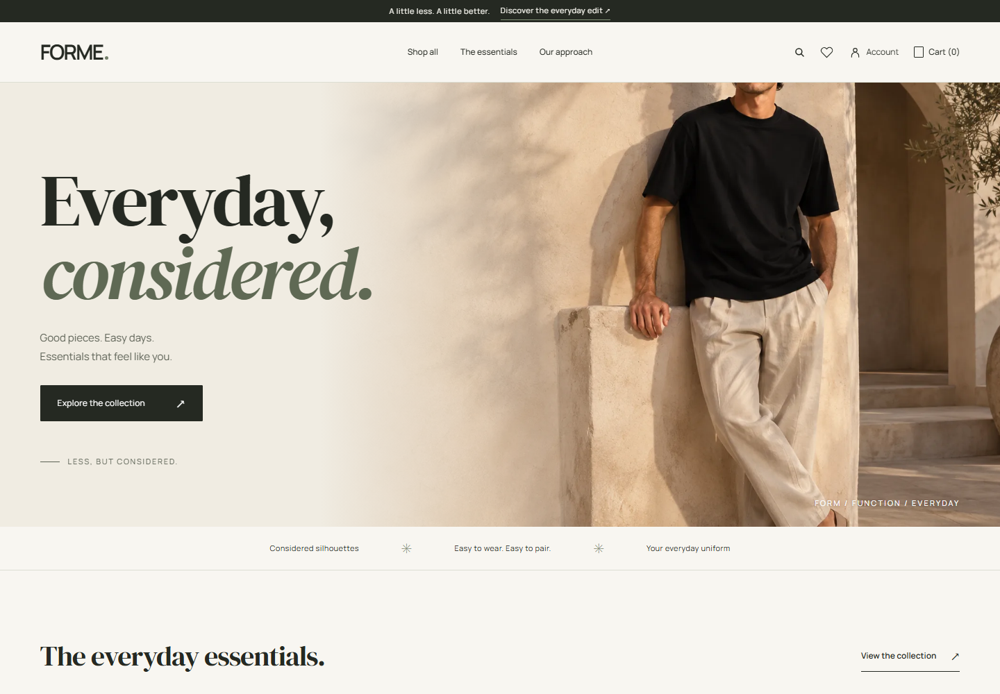
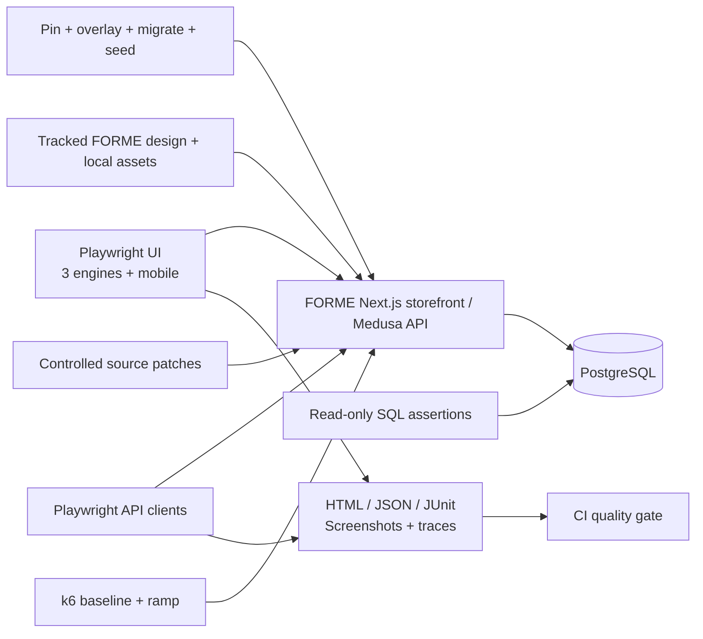

# CommerceGuard

[](https://github.com/EliyahuEden/CommerceGuard/actions/workflows/smoke.yml)
[](https://github.com/EliyahuEden/CommerceGuard/actions/workflows/regression.yml)
[](https://github.com/EliyahuEden/CommerceGuard/actions/workflows/performance.yml)

**An end-to-end QA automation framework and release quality gate for a real e-commerce
application.** It checks purchase, money and customer-isolation rules through the
browser, the API and the database, and proves the tests work by injecting known bugs
and confirming they are caught.



## Why this project exists

Most test demos run against toy pages with mocked backends, so they never meet the
failures real systems produce. CommerceGuard tests a real open-source commerce stack
(Medusa and Next.js, pinned to an exact commit) backed by a real PostgreSQL database.

A release of a shop has to prove a few things: customers are charged the right amount,
carts survive edge cases, one account can never see another's data, and the browser,
the API and the database all agree. The framework tests exactly those rules, and then
turns the results into a release decision: a gate that goes red on new failures while
tracking open product bugs separately, so a known issue cannot hide a new one.

## What it demonstrates

- **Risk-based test design:** 73 scenarios (39 API, 28 UI, 6 database) mapped to
  requirements and risks, plus 19 documented manual scenarios and exploratory charters.
- **Three-layer verification:** a UI action is checked against the API response and the
  persisted rows, using parameterized read-only SQL.
- **Cross-browser coverage:** Chromium, Firefox, WebKit and a mobile viewport, with no
  blanket retries and each test owning its own cart and customer.
- **Proof that tests catch bugs:** five reversible defects injected into the real
  storefront source, each with a pass, fail, pass cycle and restored-source hash.
- **A real bug found and tracked:** the API accepts quantity `1.5` and stores `2`
  (CG-B001), reported with severity, priority and reproduction steps.
- **Release gating:** a pull-request smoke gate, a weekly cross-browser regression, a
  known-bug register, and separate k6 performance budgets, all in GitHub Actions.
- **Accessibility:** axe A/AA scans on eight routes in four browsers, plus a
  keyboard-only purchase audit. No accessibility certification is claimed.
- **Evidence:** HTML, JSON and JUnit reports with screenshots, video and traces on
  failure.

## The application under test

The commerce system is the MIT-licensed
[Medusa DTC Starter](https://github.com/medusajs/dtc-starter), pinned to commit
[`0a84b2a`](https://github.com/medusajs/dtc-starter/tree/0a84b2ac13dbf5091a84af4b54ce0b19f6c9ad55)
and prepared into an ignored `.aut/` folder; the upstream tree is not vendored. On top
of it sits **FORME**, an original apparel storefront design (editorial photography, a
ten-product catalog, size and fit guidance, wishlist, order history and buy again) that
lives separately in [`storefront/`](storefront/) and [`aut/`](aut/).

## Architecture



- **Setup layer:** scripts pin the upstream commit, apply the FORME overlay, migrate a
  dedicated test database and seed a controlled catalog and promotion.
- **Test layer:** typed API clients with Zod contracts, page objects for the browser,
  per-test fixtures, and a restricted read-only SQL helper.
- **Evidence layer:** reports and traces feed the CI gate; the defect runner and k6
  workloads run as separate, labelled campaigns.

Design decisions are in [ARCHITECTURE](docs/ARCHITECTURE.md) and the application setup
in [AUT](docs/AUT.md).

## How releases are decided

An open upstream bug should not keep the pipeline permanently red, because a red
pipeline hides new regressions. So it is tracked instead of ignored:

| Command                   | Purpose                                                                           | Passes when                                                                                      |
| ------------------------- | --------------------------------------------------------------------------------- | ------------------------------------------------------------------------------------------------ |
| `npm run test:gate`       | Release gate: every `@regression` test except `@product-bug`                      | No test fails                                                                                    |
| `npm run test:known-bugs` | Runs only the bugs listed in [`defects/known-bugs.json`](defects/known-bugs.json) | Each registered bug **still fails**; a bug that starts passing, or a missing test, fails the job |
| `npm test`                | Everything, unfiltered                                                            | Red while CG-B001 is open; nothing is skipped or marked as an expected failure                   |

A new regression turns the gate red, CG-B001 stays visible in every run and job
summary, and a fix upstream forces cleanup of the tag, register entry and defect report.

### Injected defects

| Defect | Detecting test | Intended failure                                  |
| ------ | -------------- | ------------------------------------------------- |
| CG-D01 | UI-004         | Customer sees cart total EUR 31 instead of EUR 30 |
| CG-D02 | UI-007         | Customer sees EUR 6 discount instead of EUR 3     |
| CG-D03 | UI-003         | One add action submits two units                  |
| CG-D04 | UI-004         | Quantity 3 submits quantity 4                     |
| CG-D05 | UI-013         | Invalid credentials produce no visible error      |

The [patch manifest](defects/scenarios.json) edits actual storefront source, one change
at a time. The runner needs a passing baseline, one assertion failure, restores the
original bytes in `finally`, and requires the detecting test to pass again. No defect
is a mock server or an always-failing demonstration assertion.

## Current results

| Check                         | Outcome                                                                                         |
| ----------------------------- | ----------------------------------------------------------------------------------------------- |
| Full matrix (local, 16 Nov)   | 157 executions, **156 passed**, 1 failed: the tracked CG-B001                                   |
| Release gate (hosted, 17 Nov) | Passed across all browser projects, plus the known-bug check and keyboard audit                 |
| Smoke gate (hosted)           | 22 of 22 critical tests passed                                                                  |
| Injected defects              | 5 of 5 detected and restored                                                                    |
| Performance (k6)              | Local baseline and ramp thresholds passed; hosted baseline passed 108 requests with no failures |

Every run, including failures and what was done about them, is recorded in
[docs/RESULTS.md](docs/RESULTS.md). Counts are executions, not coverage percentages.

## What is tested

| Area                            | API                                                                                                         | UI                                                                    | SQL integration                             |
| ------------------------------- | ----------------------------------------------------------------------------------------------------------- | --------------------------------------------------------------------- | ------------------------------------------- |
| Catalog, regional price, search | Contract, query, paging, 404                                                                                | Browse, details, options, search, category                            | —                                           |
| Cart and inventory              | Create/update/delete, invalid and overflow, repeated add                                                    | Add, edit, delete, quantity limits                                    | Units, price arithmetic, no invalid write   |
| Promotions                      | Ten percent, repeated code, unknown code                                                                    | Apply, remove, displayed money                                        | Persisted adjustment                        |
| Customer, auth, access          | Register, duplicate, login, forged token, foreign address, admin denial, no credential leakage              | Register, login, logout, profile, anonymous gate                      | —                                           |
| Wishlist, sizing, accessibility | Session-scoped reads, account isolation                                                                     | Guest merge, size guide and zoom focus, axe routes, keyboard checkout | —                                           |
| Orders and contracts            | Shipping, payment, completion, duplicates, owner history, order schema and money invariants, error envelope | Full checkout and order history                                       | Order lines, completed cart, one order link |

[Traceability](docs/TRACEABILITY.md) maps test IDs to requirements, risks and manual
cases. The QA process is described in [STP](docs/STP.md), [STD](docs/STD.md),
[risks](docs/RISKS.md), [exploratory charters](docs/EXPLORATORY.md) and the
[severity and priority definitions](docs/SEVERITY_PRIORITY.md).

## Run it locally

Prerequisites: **Node 22.23.4**, npm, Git and Docker Compose v2. The application uses
local ports 8000 and 9000 and PostgreSQL on 54329. No admin account, payment credential
or secret service is needed.

```sh
git clone https://github.com/EliyahuEden/CommerceGuard.git
cd CommerceGuard
npm ci
npx playwright install --with-deps chromium firefox webkit
docker compose up -d --wait postgres
npm run aut:prepare
npm run aut:init
npm run aut:seed
npm run aut:start:production
npm run test:smoke
```

On Windows without Docker, run `npm run db:portable` in a separate terminal instead of
the `docker compose` line and keep it open; see the [Windows notes](docs/AUT.md).
Defaults work without an environment file, and `.env.example` documents every override.
Open the [storefront](http://localhost:8000/dk) once it is running.

| Command                   | Purpose                                              |
| ------------------------- | ---------------------------------------------------- |
| `npm run test:smoke`      | Critical API, integration and Chromium tests         |
| `npm run test:gate`       | Release gate, all browsers, known bugs excluded      |
| `npm run test:known-bugs` | Confirm tracked bugs still reproduce                 |
| `npm test`                | Every test; red while CG-B001 is open                |
| `npm run test:keyboard`   | Keyboard-only purchase audit with axe scans          |
| `npm run test:defects`    | Inject, detect, restore and re-pass all five defects |
| `npm run test:perf`       | Local k6 baseline (needs the k6 executable)          |
| `npm run report`          | Open the latest HTML report                          |
| `npm run aut:stop`        | Stop the processes this workspace started            |

Run one test with `npx playwright test --project=chromium --grep UI-007`. Performance
budgets are in [PERFORMANCE](docs/PERFORMANCE.md). To clean up, run `npm run aut:stop`
and `docker compose down --volumes`.

## CI/CD

Three GitHub Actions workflows share one setup action that installs dependencies,
starts PostgreSQL, prepares and seeds the pinned application and waits for readiness:

- **`smoke.yml`:** on pull requests and pushes, typechecks and runs 22 critical tests
  plus the keyboard audit. Make _PR release quality gate / smoke_ a required check.
- **`regression.yml`:** weekly and on demand across all browsers; runs the release
  gate, the known-bug check and the keyboard audit, then uploads the Playwright JSON.
- **`performance.yml`:** on demand, baseline or ramp k6 workload.

Reports, traces and logs are uploaded as artifacts even when a test fails. The weekly
JSON artifact can feed [FlakeGuard](https://github.com/EliyahuEden/FlakeGuard), the
companion project that turns test history into flaky-test and recurring-failure
evidence.

## Project structure

```text
aut/                   Medusa catalog and promotion seed, hydration probe
storefront/            FORME design, assets, exact patches and attribution
config/aut.json        Upstream commit and toolchain pin
src/api/               HTTP client, Zod contracts, checkout and auth helpers
src/data/              Unique test-data factories
src/db/                Restricted read-only PostgreSQL helper
src/fixtures/          Per-test request and database lifetimes
src/pages/             Browser page objects
tests/api/             Contract, business-rule and authorization tests
tests/ui/              Browser commerce workflows
tests/integration/     UI, API and SQL persistence checks
performance/           k6 workload and thresholds
defects/               Injected-defect patches and the known-bug register
scripts/               Application lifecycle, portable database, defect and evidence runners
docs/                  QA documents, decisions and measured evidence (start at docs/README.md)
```

## Limitations and next steps

The small seeded dataset and in-memory event, lock and cache adapters do not prove
distributed behavior or production performance. Mobile coverage is viewport emulation.
Real payment settlement and refunds, email delivery, multi-region tax rounding,
concurrent order completion, low-stock contention and a full accessibility audit are
future work. SQL assertions intentionally couple to the pinned schema.

Next: report the quantity-coercion finding upstream, add Redis-backed concurrency and
low-stock scenarios, test tax rounding across currencies and extend accessibility
coverage, adding tests where they protect a stated risk rather than to raise counts.

## License

MIT. The upstream Medusa DTC Starter keeps its own MIT license; see
[`storefront/UPSTREAM_LICENSE`](storefront/UPSTREAM_LICENSE) and
[`storefront/ASSET_PROVENANCE.md`](storefront/ASSET_PROVENANCE.md).
