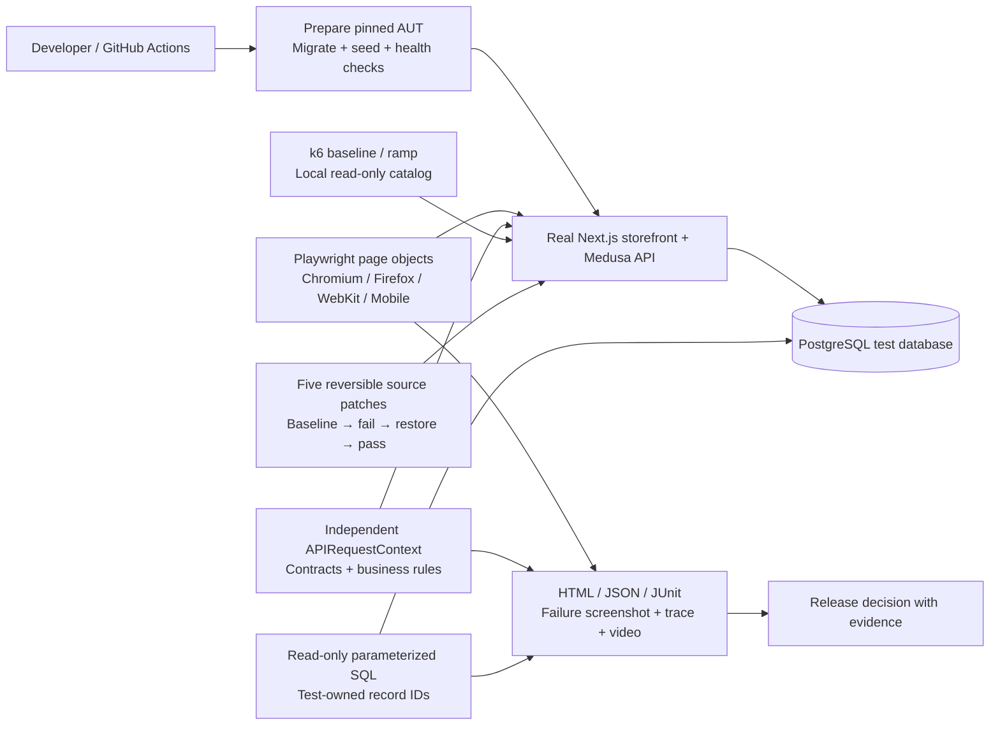

# Architecture and decisions

| Decision                                                     | Reason and tradeoff                                                                                        |
| ------------------------------------------------------------ | ---------------------------------------------------------------------------------------------------------- |
| Standalone QA repository and ignored pinned clone            | Original work is reviewable; setup needs network for initial clone/install                                 |
| Playwright for browser and API, independent request context  | One assertion/report stack; API tests have no browser prerequisite                                         |
| Native HTML report + JSON/JUnit instead of Allure            | Traces, steps and attachments without Java/report-server dependencies                                      |
| No automatic retries                                         | A real failure blocks the relevant gate; stability is measured via explicit repeat runs                    |
| Unique accounts/carts                                        | Parallel isolation without shared auth state; records accumulate in disposable DB                          |
| Read-only PostgreSQL adapter and SQL in integration suite    | Checks persistence without modifying product data behind Medusa's workflows; queries tied to pinned schema |
| Existing semantic roles/test IDs plus a null hydration probe | Avoid pre-hydration lost events; explicit small AUT instrumentation maintained under `aut/`                |
| Default local event/cache/lock adapters                      | Reproduce starter without Redis; cannot claim distributed lock/race coverage                               |
| Manual payment provider                                      | Exercises actual payment-session/order workflows without charges; does not certify gateway behavior        |
| Five source mutations in storefront                          | Measures detection against real UI/API behavior; these are examples, not an exhaustive mutation score      |
| Separate k6 job                                              | No load interference with correctness suites; small local dataset limits capacity conclusions              |

`src/config.ts` validates local endpoints; `src/api` owns HTTP helpers and contracts;
`src/data` owns per-test factories; `src/pages` encapsulates interactions; `src/fixtures`
owns request/database lifetimes; `tests/{api,ui,integration}` expresses business
expectations; `performance` owns k6 workloads; `scripts` owns lifecycle/evidence;
`aut` contains the original seed/instrumentation copied into the ignored application.

`storefront` contains the independently maintained FORME presentation overlay, local
assets, and exact-match patches. `aut:prepare` applies it to the pinned checkout;
`aut:seed` uses official core workflows to create missing collections, products and
inventory levels, apply catalog text, and reconcile variant image associations.
Repeat seeding does not replenish existing inventory. Commerce, order, authentication and persistence behavior remain
Medusa implementations. See [the storefront decisions](STOREFRONT.md).

Seeding explicitly awaits derived search ingestion before exit. The normal local
event bus can finish after a CLI script, so relying only on product-update events
can leave a document stale. The catalog smoke contract independently compares the
search index's title/image projection with the Store API's current records.

There is no mock commerce service, in-memory fake database or intercepted successful
checkout response. API setup creates real prerequisites. Browser tests still perform
the user action being asserted. SQL checks use the actual tables inspected in the
pinned package models/migrations: `cart`, `cart_line_item`,
`cart_line_item_adjustment`, `order_item`, `order_line_item`, `order_cart`.

The wishlist read boundary is a same-origin, private/no-store GET route that derives
the customer from its HttpOnly session. Wishlist writes use authenticated server
actions and the existing customer metadata contract; simultaneous account writes
use last-write-wins semantics. Guest lists merge only after a successful account
write. Account order pages verify ownership before metadata/details render; buy
again creates a new real cart with current price/stock and never creates an order.

Quality gates compile and run the Next.js production server. Source mutation uses
development compilation so each injected patch is exercised. Production localhost
HTTP cookies require an explicit private test flag plus exact loopback origins;
other production configurations retain Secure cookies. Process teardown verifies
the recorded PID still belongs to this workspace before stopping it.
