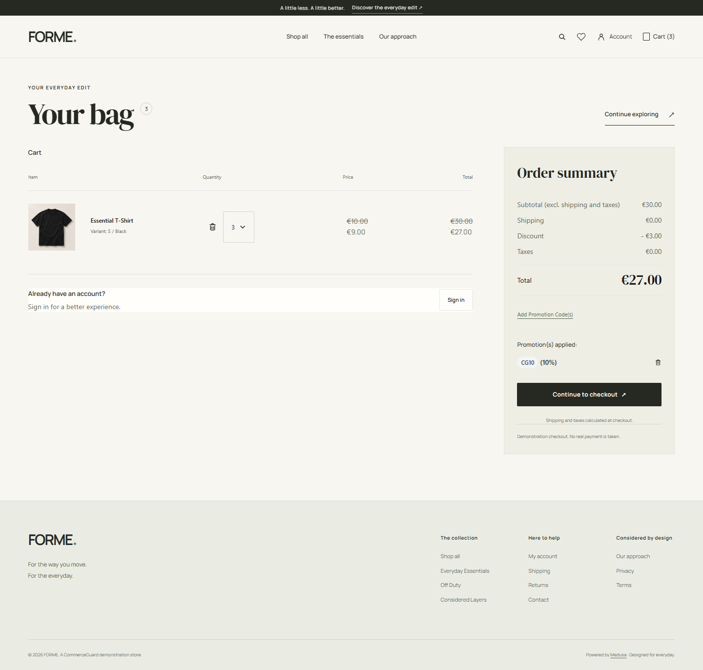
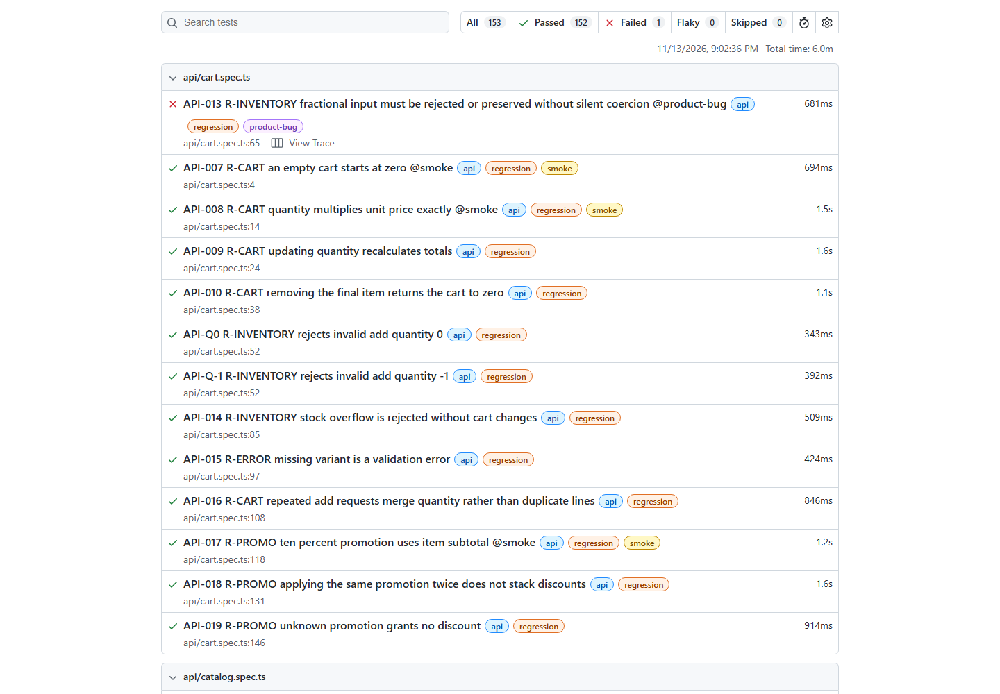

# Verification history

Dated, measured records of each campaign, newest first. The README carries only the
current summary; this page keeps the detail, including what failed and why. All
counts are executions of the Playwright suite; executions are not additional unique
scenarios or coverage percentages.

## 17 November 2026 — hosted gate and FlakeGuard sync

- The manually dispatched
  [regression run 44030780120](https://github.com/EliyahuEden/CommerceGuard/actions/runs/44030780120)
  passed the release gate (`npm run test:gate`), the known-bug check
  (`npm run test:known-bugs`) and the keyboard audit, and uploaded the
  `playwright-json-results` artifact.
- The push-triggered smoke workflow passed on the same revision
  ([run 44028885938](https://github.com/EliyahuEden/CommerceGuard/actions/runs/44028885938)).
- A live `flakeguard sync` against this repository's hosted runs imported 156
  executions from each of two regression runs. A third run without the artifact was
  recorded as a retryable error, as designed.

## 16 November 2026 — contract tests and storefront polish (local, Node 22.23.4)

Four API contract scenarios were added (API-036 to API-039: completed-order schema
and money invariants, one JSON error envelope, typed shipping prices, no credential
fields in customer responses), followed by a storefront polish pass.

| Check                                                  | Outcome                                                                                                                                         |
| ------------------------------------------------------ | ----------------------------------------------------------------------------------------------------------------------------------------------- |
| Full matrix                                            | 157 executions from 73 unique scenarios (39 API, 28 UI, 6 integration): **156 passed / 1 failed**; the failure is the tracked CG-B001 (API-013) |
| Baseline smoke on the rebuilt stack, before the polish | 22/22 passed                                                                                                                                    |
| `npm run test:gate`                                    | 156/156 passed                                                                                                                                  |
| `npm run test:known-bugs`                              | CG-B001 still reproducing (exit 0)                                                                                                              |

The polish removed decorative all-caps labels above headings and the repeated card tag,
raised text declared at 8–10px to 11px, and aligned money with tabular numerals.

**One intermittent failure was found and fixed.** The first matrix after the polish
also failed UI-019 on mobile Chromium. The trace showed the closing menu panel,
visually gone, still intercepting clicks for the whole timeout. The test passed 3 of 3
when re-run alone, so it was intermittent. The panel now ignores pointer events while
it leaves. Two full matrices since then were clean, which is encouraging but cannot
prove an intermittent defect is gone.

## 14 November 2026 — shopping enhancements, local and hosted

The local 13 November matrix executed **153 checks from 69 unique scenarios**:
**152 passed / 1 product failure**, with zero skips, retries or flaky outcomes, in
357.81 seconds. All 112 UI checks across Chromium, Firefox, WebKit and mobile Chromium,
and all six database integration checks, passed. API-013 exposes CG-B001 (accepted
quantity `1.5` becomes `2`).

The hosted matrix also measured 152 passed / 1 product failure in 208.85 seconds.
Hosted smoke passed 22/22 plus the keyboard audit, and the separate hosted k6 baseline
passed 108 requests with zero HTTP or business failures. Docker setup and cleanup ran
on the runner. See [the hosted run manifest](evidence/enhancements/hosted-actions.json),
the [full verification report](ENHANCEMENT_RESULTS.md),
[per-case outcomes](evidence/enhancements/regression-results.json) and the
[requirements audit](REQUIREMENTS_AUDIT.md).

The critical smoke selection passed 66/66 across three explicit repeat cycles without
retries ([measured outcomes](evidence/enhancements/stability-results.json)).

The six enhancements covered a varied ten-product catalog, size/fit/care and zoom,
mobile address validation, guest/account wishlist, order statuses with buy again, and
keyboard plus axe accessibility checks. The
[12 November redesign report](archive/REDESIGN_RESULTS.md) preserves the earlier
117-execution campaign.

## 11 November 2026 — original QA baseline

| Campaign        | Measured outcome                                                                                |
| --------------- | ----------------------------------------------------------------------------------------------- |
| Full matrix     | 104 passed / 1 product failure, 105 executions, zero skips or retries                           |
| Smoke stability | 45/45 passed — 15 critical cases repeated three times                                           |
| Seeded defects  | 5/5 detected and restored, each with pass → fail → pass evidence                                |
| Local k6        | Baseline: 102 requests, p95 305.93 ms; ramp: 327 requests, p95 246.91 ms; all thresholds passed |

Earlier compilation and transport failures, their fixes and the final repeat are in the
[test summary](STR.md). At the time of this campaign neither Docker nor hosted Actions
had been executed. The original baseline is also available at Git tag
`baseline-medusa-qa`.

## Screenshots

Three EUR 10 items with the CG10 promotion produce a EUR 3 discount and a EUR 27 total:

The report keeps the independently discovered API failure visible:

